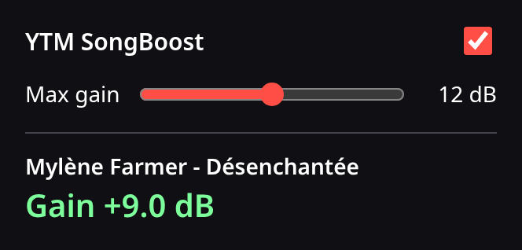

# YTM SongBoost

Chrome extension that makes quiet songs on YouTube Music louder.

YouTube Music turns loud songs down but not quiet songs up. For each song below its loudness target, this extension raises the player volume by the difference, up to the max gain. The volume stays fixed for the whole song.

The volume can't go above 100%, so lower the YouTube Music volume to leave room.

The icon shows the current boost in dB. Orange means the volume is too high for the full boost.

## Install

Install it from the [Chrome Web Store](https://chromewebstore.google.com/detail/ytm-songboost/dbdcobjecpomicdekfahbcilbmlnioni).

To load it from a release instead:

1. Download the zip from [Releases](../../releases) and unzip it.
2. Open `chrome://extensions` and turn on Developer mode.
3. Click Load unpacked and select the unzipped folder.
4. Reload YouTube Music.

## Build

    node scripts/build.mjs
